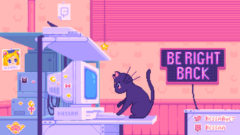

<p align="center">
  
</p>

<p align="center">
  
</p>

<p align="center">
  
</p>

---

## 💜 Sobre mim

<table>
<tr>
<td width="55%">

```js
const eu = {
  nome: "Lavinea",
  local: "Brasil 🇧🇷",
  estudando: ["JavaScript", "React", "Python"],
  hobbies: ["código", "games", "fazer carinho em gatos 🐱"],
  frase: "take breaks! drink water :3",
};
```

</td>
<td width="45%" align="center">
  
</td>
</tr>
</table>

---

## 🌸 Conecte-se comigo

<p align="center">
  <a href="https://linkedin.com/in/LavineaSubtil"></a>
  <a href="https://instagram.com/LavineaSubtil"></a>
  <a href="#"></a>
  <a href="#"></a>
</p>

---

## 🛠️ Tecnologias

<p align="center">
  
</p>

---

## 📊 GitHub Stats

<p align="center">
  
  
</p>

<p align="center">
  
</p>

<p align="center">
  
</p>

---

## 🏆 Troféus

<p align="center">
  
</p>

---

<p align="center">
  <i>"take breaks! drink water, rest your eyes :3"</i> 🐾💜
</p>
