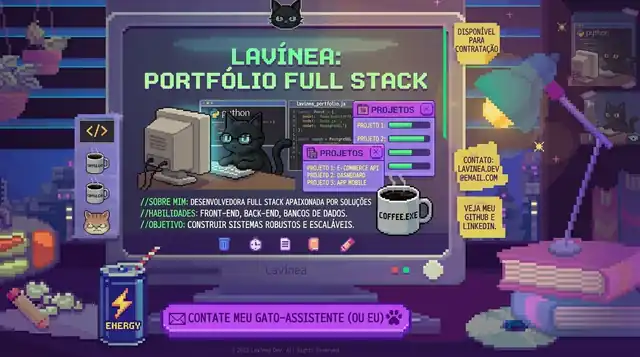
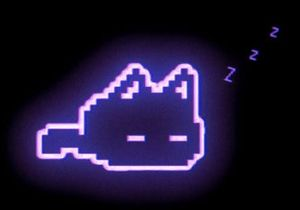

<p align="center">
  
</p>

<p align="center">
  
</p>

<p align="center">
  
</p>

---

## 💜 Sobre mim

Desenvolvedora **front-end e UI/UX** que usa **IA e automação** para construir soluções de ponta a ponta, do protótipo no Figma ao código em React.

- 💼 Ex-estagiária de TI na **Banestes Asset Management** (fev/2025 – jun/2026): front-end, UI/UX, sistemas internos e automações
- ⚙️ Automações em **Google Apps Script** que eliminaram tarefas manuais de **2 a 3 horas**
- 🤖 Construo agentes de IA com **n8n** e **Gemini** ([Pixel Bistrô](https://pixel-bistro-site.vercel.app)) e uso **Claude** e **Gemini** no dia a dia
- 📚 Cursando a formação **AI Driven Development** (Formação.Dev)
- 🎓 Análise e Desenvolvimento de Sistemas (UCL), conclusão prevista em **jul/2027**

<table>
<tr>
<td width="55%">

```js
const eu = {
  nome: "Lavinea",
  local: "Serra/ES 🇧🇷",
  foco: ["front-end", "UI/UX", "IA e automação"],
  estudando: ["AI Driven Development", "React", "Python"],
  hobbies: ["código", "games", "fazer carinho em gatos 🐱"],
  frase: "take breaks! drink water :3",
};
```

</td>
<td width="45%" align="center">
  
</td>
</tr>
</table>

---

## 🛠️ Tecnologias

<p align="center">
  
</p>

---

## 🚀 Projetos

<table>
<tr>
<td colspan="2" valign="top">

### 🍔 [Pixel Bistrô](https://pixel-bistro-site.vercel.app) · agentes de IA para delivery

Agentes com **n8n + Gemini** que leem pedidos e avaliações de um restaurante: respondem o cliente na hora, mandam alerta quando a avaliação é ruim e enviam um relatório semanal com métricas e ações. [Testar o site](https://pixel-bistro-site.vercel.app) · [Ver o código](https://github.com/LavineaSubtil/pixel-bistro)


</td>
</tr>
<tr>
<td width="50%" valign="top">

### 🔥 [Simulador de Troca de Calor](https://github.com/LavineaSubtil/SimuladorTrocaCalor)

Cubos de materiais reais trocando calor pela Lei de Fourier, com mapa de cores por temperatura e computação paralela.


</td>
<td width="50%" valign="top">

### 🌐 [Portfólio](https://portfolio-eta-one-ae9ei5wnug.vercel.app/)

Meu cantinho na web, com quem eu sou e o que ando construindo.


</td>
</tr>
<tr>
<td width="50%" valign="top">

### 🦪 Projeto Sururu

Software de gestão que estou construindo do zero, com autenticação e banco de dados. *(em desenvolvimento)*


</td>
<td width="50%" valign="top">

### 🏦 [Banestes Investimentos](https://www.banestes.com.br/site/asset/)

Site institucional da gestora: front-end, UI/UX e a persona Alana, do esboço à arte final.


</td>
</tr>
</table>

---

## 📫 Contato

<p align="center">
  <a href="https://portfolio-eta-one-ae9ei5wnug.vercel.app/"></a>
  <a href="https://www.linkedin.com/in/lav%C3%ADnea-subtil-ba290a355"></a>
  <a href="mailto:lavineasubtil10@gmail.com"></a>
</p>

---

## 📊 GitHub Stats

<p align="center">
  
</p>

---

<p align="center">
  <i>"take breaks! drink water, rest your eyes :3"</i> 🐾💜
</p>
